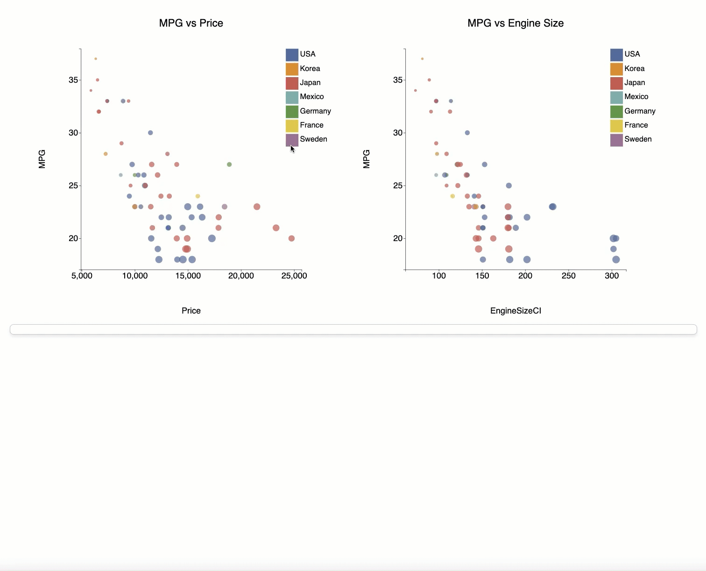

# Major Assignment: Linked Scatterplots with Brushing
### Multiple Views · Data Reduction · Focus + Context

## Goal

Complete the Activity 7 starter so that brushing a region in either scatterplot selects the matching cars in **both** plots, and the selected cars are listed below the plots. The finished page should behave like the GIF:

---

## Instructions

### Step 1: Review the existing code
Review the `scatter_plot` function in `js` to understand its structure. Pay close attention to how data is bound to the graphical elements and how the axes are drawn. Refer to the GIF above. The scatterplot function is also explained in the week 12 GitHub repos.

### Step 2: Complete the missing code
The code is marked with `// Missing Part N` comments.

| # | File | Requirement | Pts |
|---|---|---|---|
| 1 | `../src/index.html` | Draw a second scatterplot in `#figure2`, titled **"MPG vs Engine Size"**: `x = EngineSizeCI`, `y = MPG`, size = `Weight`, colour = `Country` | 15 |
| 2 | `../src/index.html` | Add one `<li>` to the list for each selected car | 15 |
| 3 | `../src/index.html` | Each `<li>` shows the car's details as `"<Model> - <Type>"` | 15 |
| 4 | `scatterplot.js` | Clicking on the plot (a new brush with no extent) removes the `selected` class from every circle | 15 |
| 5 | `scatterplot.js` | Hovering over a legend swatch adds the `legendSelect` class to that country's circles and swatch in **both** plots; moving the mouse away removes it | 25 |

### Step 3: Implement brushing
Brushing in either plot must select the matching data points in **both** plots (see GIF).

### Step 4: Update the list display
When a brush selection is made, the list below the plots must update to show the details of the selected cars.

---

## Grading Criteria

| Criterion | Pts |
|---|---|
| Missing Parts 1–5 completed (table above) | 85 |
| Working GitHub Pages view of the visualization | 15 |
| **Total** | **100** |

Your finished page must also show that:
- the brush selects the data points in both scatterplots;
- the selected cars are added to the list with their details;
- clicking on the SVG clears the brush selection.

---

## Submission

Submit:
- the working code as a **.zip**, including every file it needs so that it also runs offline;
- your **GitHub Pages URL**;
- a **screenshot of your code**.
